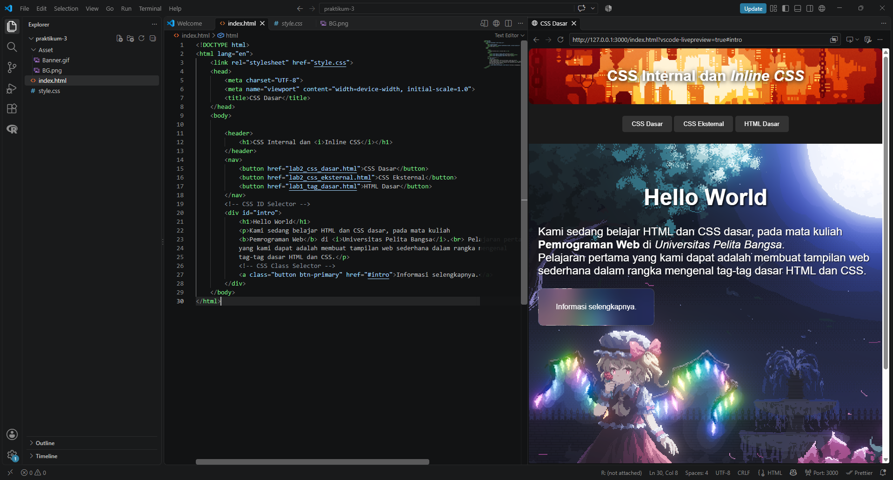
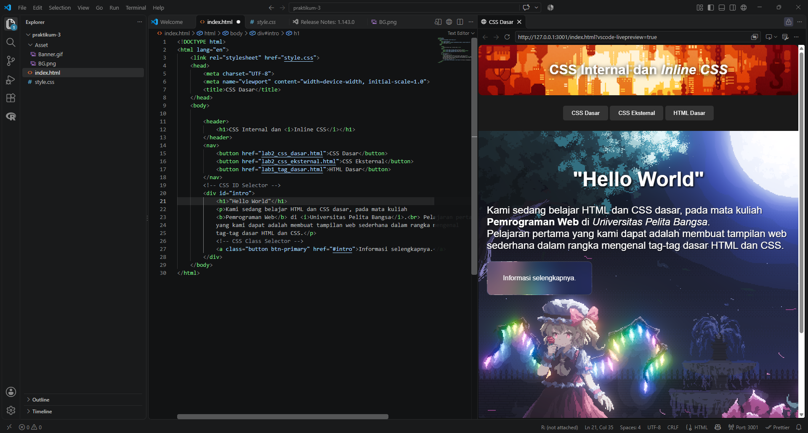
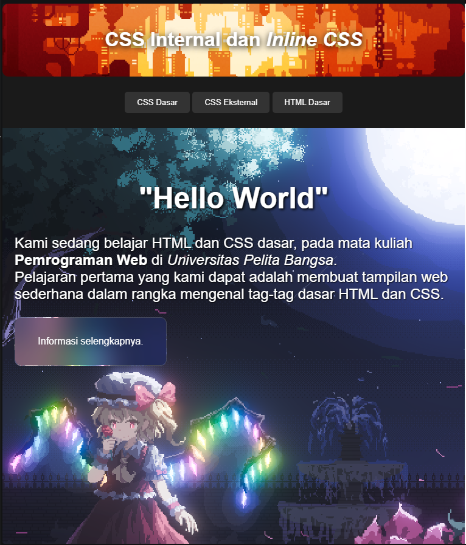
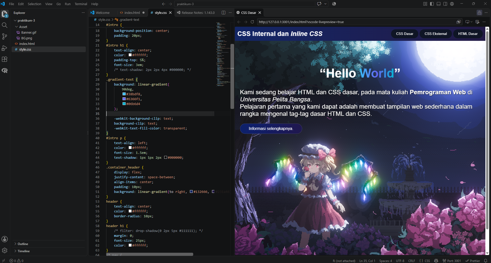

# Praktikum 3 --- CSS Dasar

Proyek sederhana untuk praktikum **Pemrograman Web** yang menampilkan
halaman pengenalan HTML dan CSS. Halaman menggunakan gambar banner,
latar belakang ilustrasi, navigasi, serta teks judul dengan efek
gradient.

## Tampilan

### Screenshot 1 --- Halaman utama



### Screenshot 2 --- Penerapan teks gradient


### Screenshot 3 --- Struktur HTML



### Screenshot 4 --- Styling CSS



### Screenshot 5 --- Hasil akhir halaman



> Pastikan folder `ss` berada di direktori yang sama dengan README ini
> dan berisi file `ss1.png` sampai `ss5.png`. Nama file dan huruf
> besar-kecilnya harus sesuai.

## Fitur

-   Header dengan gambar banner.
-   Navigasi menuju materi CSS Dasar, CSS Eksternal, dan HTML Dasar.
-   Bagian intro dengan gambar latar.
-   Teks judul "Hello World" dengan efek gradient pada kata **World**.
-   Garis dekoratif dengan gradient.
-   Tombol "Informasi selengkapnya" dengan tampilan transparan.

## Teknologi

-   HTML5
-   CSS3

## Struktur Folder

``` text
praktikum-3/
├── Asset/
│   ├── Banner.gif
│   └── BG.png
├── ss/
│   ├── ss1.png
│   ├── ss2.png
│   ├── ss3.png
│   ├── ss4.png
│   └── ss5.png
├── index.html
├── style.css
└── README.md
```

## Cara Menjalankan

1.  Pastikan file `index.html`, `style.css`, dan folder `Asset` berada
    pada struktur folder yang sesuai.
2.  Buka `index.html` di browser, atau jalankan menggunakan ekstensi
    **Live Server** di Visual Studio Code.
3.  Jika gambar tidak muncul, periksa kembali path gambar di CSS dan
    pastikan nama file cocok.

## Catatan Implementasi

Efek gradient pada kata **World** dibuat dengan membungkus kata tersebut
menggunakan elemen `<span>`:

``` html
<h1>“Hello <span class="gradient-text">World</span>”</h1>
```

Kemudian gradient diterapkan melalui CSS:

``` css
.gradient-text {
    background: linear-gradient(90deg, #38bdf8, #6366f1, #06b6d4);
    -webkit-background-clip: text;
    background-clip: text;
    -webkit-text-fill-color: transparent;
}
```

Dengan cara ini, gradient hanya diterapkan pada kata **World**,
sedangkan teks lainnya tetap mengikuti warna dari elemen judul.
